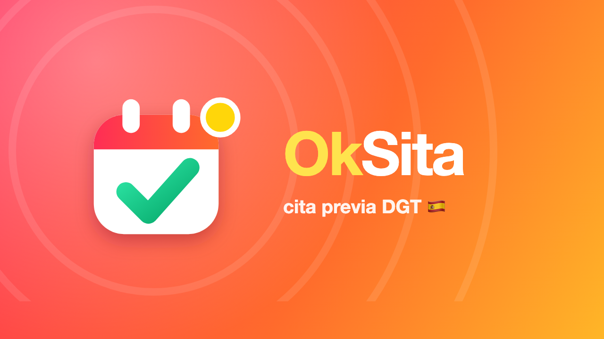

<p align="center"></p>

# OkSita — свободные citas DGT в Telegram

Telegram-бот [@oksitabot](https://t.me/oksitabot) следит за записью (cita previa) в DGT — Tráfico —
и присылает уведомление, как только в выбранном офисе появляются свободные даты.

## Для пользователей

- любой из 68 офисов DGT; типы записи берутся с сайта для каждого офиса;
- уведомление с ближайшей датой, свободным временем и списком дней с загрузкой (🟢 🟡 🔴);
- календарь кнопками, фильтр «только даты в пределах N дней», пауза, история появления мест;
- 📡 радар: проверяет ближайшие офисы и показывает, где записаться раньше всего;
- ✅ «Я записался»: дата и время визита, напоминание накануне и утром, список документов;
- четыре языка: украинский, русский, испанский, английский (выбор при первом запуске, /lang, в мини-приложении), памятка для украинцев;
- мини-приложение для Premium: офисы и календарь, запись на визит, радар, сигналы о документах, бонусы, язык и настройки;
- 🎁 пробный Premium на 3 дня: один раз на человека, из меню, Premium и мини-приложения;
- 💼 вакансии и реклама в канале: оплата звёздами, проверка администратором, возврат при отказе; заявки партнёров;
- 📢 канал @oksita_news: даты DGT с задержкой 30 минут (в боте сразу), итоги недели по воскресеньям в 19:00,
  «ещё одна запись» — анонимно, только если человек сам нажал кнопку после записи;
- 🎁 бонусная лестница: каждое задание и друг дают +1 день Premium, после 2 заданий — скидка −10% на месяц (30 дней, один раз);
- ⚖️ честная частота проверок: интервалы сами растягиваются под лимит сайта DGT, Premium проверяется первым, люди видят реальные минуты;
- 📊 статистика офисов за 30 дней, ⏰ окна проверки для TIE, 📋 памятка по записи на TIE, 🛡 гарантия на первую оплату;
- **чистый чат**: один экран на человека, уведомление по офису одно и правится, когда даты пропадают;
- 🔒 **подписка на канал обязательна**: без неё бот и мини-приложение показывают экран «подпишись»; как только человек
  вступил, Telegram присылает `chat_member`, и меню открывается само. Вышел из канала — уведомления на паузе (раз в сутки
  бот объясняет почему). Язык, /privacy, /terms и /paysupport работают всегда. Выключается в Админ → Канал;
- 📱 **объявления из мини-приложения**: текст, фото, предпросмотр «как в канале», оплата звёздами прямо в приложении;
  открываются кнопкой «Подать в приложении» (`/app?screen=post`) и без Premium;
- 💬 **группа канала**: бот находит группу обсуждения канала сам, здоровается с новичками (одно приветствие, исчезает
  через 10 минут), удаляет «вступил/вышел», продажу записей и ссылки от тех, кто вступил меньше суток назад;
- 🏫 **автошколы**: заявка в боте (`?start=school`), админ выдаёт код одной кнопкой — 7 дней Premium на 100 учеников,
  ссылка, QR и страница-плакат для печати `/s/КОД`; в админке видно, сколько учеников пришло и заплатило;
- ⭐ **отзывы**: на следующий день после визита бот просит оценку; на сайт и в канал — только с согласия и после проверки,
  без имени; низкую оценку видит только админ;
- 🌐 **сайт** на `/` (ES), `/uk`, `/ru`, `/en`: для поиска в Google, с FAQ, тарифами и живыми цифрами; `robots.txt`, `sitemap.xml`.

Записывается пользователь сам — бот только уведомляет.

## Тарифы

| | Бесплатно | Premium |
|---|---|---|
| Офисов | 2 | 10 |
| Проверка | раз в 30 минут | раз в 5 минут, первым в очереди |
| Ручная проверка | раз в 30 минут | раз в минуту |
| Радар | 1 в день, до 100 км | без ограничений, до 250 км |
| Мини-приложение | нет | да (демо) |
| Реклама | только по согласию | нет |

Оплата Telegram Stars: 7 дней — 39 ⭐, 30 дней с автопродлением — 99 ⭐, 90 дней — 249 ⭐. Цены и лимиты меняются в админке.
Premium можно получить бесплатно: 🎁 бонусы за друзей и задания, 🎟 промокоды.

**Canje.** С октября 2026 DGT открывает календарь canje только после заявки с NIE, датой рождения и страной.
Бот личные данные не вводит, поэтому показывает статус 🔐 и объясняет порядок, а даты canje не отслеживает.

**🛂 Документы.** Записи на TIE, NIE, паспорт и в консульство закрыты капчей и антибот-защитой, бот их не проверяет.
Вместо этого работают сигналы от людей: пользователь подписывается на провинцию и документ, а тот, кто увидел места,
нажимает кнопку. В сигнале только провинция и тип документа, без текста и ссылок от людей. Повтор за 30 минут считается
подтверждением, 5 сигналов в сутки на человека, после 3 опровергнутых сигналов кнопка отключается.

**Рефералка.** Ссылка `t.me/oksitabot?start=r_КОД`. Друг выбрал язык, добавил офис и подписался на обязательный канал
(если он задан) — оба получают +1 день. Пригласивший тоже должен быть подписан. Лимит — 10 наград за 30 дней.

**Промо-ссылки.** `t.me/oksitabot?start=promo_КОД` — создаются в админке: срок Premium, лимит использований, срок действия.

## Админ-панель

Команда `/admin` или кнопка в меню (для владельцев из `ADMIN_CHAT_ID` и назначенных админов):

- 📈 аналитика: таблица за 7 дней, воронка до оплаты, топ офисов, источники (`?start=метка`): сколько пришло, подписалось, заплатило;
- 🩺 система: связь с DGT, загрузка очереди, ошибки, память, webhook, диагностика соединения;
- 👥 пользователи: поиск, карточка, выдача и снятие Premium, бан, личное сообщение, возврат оплаты;
- 🏢 офисы: статус, кто следит, отключение проверки;
- 💰 доход: баланс Stars, оплаты, цены;
- 🎟 промокоды, 📝 задания (канал или ссылка, обязательный канал для рефералки);
- 📣 реклама: кампании с меткой, только по согласию, переходы и CTR;
- 🏫 автошколы: коды, плакаты, QR, кто пришёл и заплатил; ⭐ отзывы: на сайт, в канал, скрыть;
- 📢 канал: обязательная подписка вкл/выкл, 💬 группа канала, задержка постов о датах, закреплённый пост, 🗓 отложенные посты (свой текст, фото, видео или готовые заготовки
  с картинками; время на выбор или «по одному в день в 19:00»), итоги недели и «ещё одна запись» вкл/выкл;
- 📢 рассылка по сегментам, 📤 экспорт CSV, ⚙️ настройки, 📜 журнал, вечерний отчёт.

Ссылки с разделом и меткой площадки: `t.me/oksitabot?start=trial-bcn` открывает пробный период и записывает источник `trial-bcn`.
Разделы: trial, post, partner, school, stats, tie, radar, premium, bonus, docs.

## Как устроено

| Файл | Что внутри |
|---|---|
| `dgt.py` | шаги на сайте DGT и чтение календаря |
| `checker.py` | очередь проверок, уведомления, сбои сайта, напоминания, отчёт |
| `views.py` | все экраны и тексты бота на четырёх языках: `tx(lang, ru, uk, es, en)` |
| `webapp.py`, `webapp/` | webhook, API и мини-приложение; его тексты в `webapp/i18n.js` |
| `admin.py` | админ-панель |
| `premium.py` | тарифы, оплата Stars, продление, окончание |
| `rewards.py` | друзья, задания, промокоды |
| `signals.py` | сигналы от людей о записях на документы |
| `channel.py` | посты в канале: даты с задержкой, отложенные посты, итоги недели, «ещё одна запись», закреплённый пост |
| `posts.py` | готовые посты для канала (текст UA/RU, картинка `assets/post_*.jpg`) |
| `board.py` | объявления: проверка текста, оплата, модерация, публикация |
| `gate.py` | обязательная подписка на канал |
| `group.py` | группа канала: приветствие, порядок, защита от продавцов записей |
| `schools.py` | автошколы: промокод, QR, плакат для печати |
| `reviews.py` | отзывы после визита |
| `landing.py` | сайт для поиска: страница на 4 языках, robots.txt, sitemap.xml |
| `stats.py` | статистика офисов за 30 дней |
| `ads.py` | рекламные кампании |
| `actions.py` | действия, общие для бота и мини-приложения |
| `radar.py` | ближайшие офисы, подбор типа записи |
| `tg.py` | Telegram API и «чистый чат» |
| `store.py` | данные в памяти, запись в Postgres (Neon) фоновой очередью |
| `bot.py` | маршрутизация и запуск |
| `tests/` | автотесты (`python3 -m unittest discover tests`), `tests/devserver.py` — просмотр мини-приложения без Telegram |

К сайту бот ходит по одному запросу с паузами. Если сайт недоступен, проверки переходят в редкие пробы
(от 5 минут до часа), пользователи видят предупреждение, а оплата закрывается.

## Хостинг (бесплатно)

- **Render Free** (Frankfurt): webhook + обращение к себе раз в 9 минут, чтобы сервис не засыпал.
  Лимит Render — 750 бесплатных часов в месяц на аккаунт, бот тратит ~744.
- **Neon Free** — Postgres для подписок и истории.

Переменные на Render: `TELEGRAM_TOKEN`, `DATABASE_URL`, `ADMIN_CHAT_ID`.
Новая версия выкатывается кнопкой **Manual Deploy → Deploy latest commit**.

## Локальный запуск

```bash
cp .env.example .env   # вставить TELEGRAM_TOKEN
pip3 install -r requirements.txt
python3 bot.py
```

Если бот уже работает на Render, локальный запуск откажется стартовать, чтобы не отключить сервер
(`python3 bot.py --force` — если это действительно нужно).

## Картинки и реклама

- `python3 assets/make_brand.py` — логотип, аватар и баннеры разделов;
- `python3 assets/make_posts.py` — картинки постов канала (`assets/post_*.jpg`) и рекламы для чатов
  (`promo/img/*_uk.jpg`, `*_ru.jpg`). Нужен Google Chrome.
- `python3 assets/make_video.py` — вертикальное видео 14 с для Reels/TikTok (`promo/video/oksita_uk.mp4`, `_ru`, `_es`);
  нужны `pip install playwright` и ffmpeg;
- `promo/index.html` (не в git) — тексты для чатов на UA/RU/ES с кнопками «Скопировать»;
  ссылки сразу с меткой выбранной площадки.
